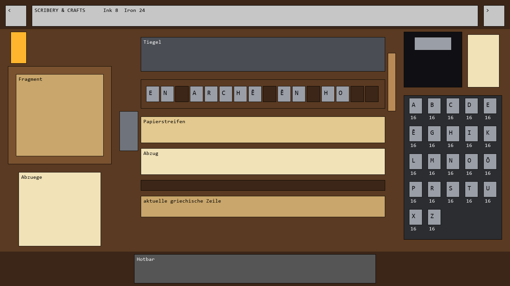

# Phase 0: UI-Raster, Maße, Palette, Datenformat

Stand: 15.11.2026. Gehört zu [plan.md](plan.md), Abschnitt 5 (Phase 0) und 6 (Presse).

Die Zahlen stehen nur an einer Stelle: [art/layout.json](../art/layout.json) und [art/palette.json](../art/palette.json). Dieses Dokument erklärt sie. `python art/mockup.py` zeichnet daraus das Kontrollbild [art/out/press-mockup.png](../art/out/press-mockup.png) und meldet Überlappungen.

## 1. Leinwand

- **384 × 216 GUI-Pixel** (16:9), zentriert im Fenster. Der Rest des Bildschirms wird abgedunkelt.
- Passt ohne Skalierung bei 1920×1080 bis GUI-Scale 5, bei 1280×720 bis Scale 3 und im Standardfenster 854×480 bei Scale 2.
- Ist das Fenster in GUI-Pixeln kleiner als 384 × 216, wird die ganze Leinwand ganzzahlig herunterskaliert (nie gebrochen, sonst mischt der Pixel-Look).
- **1 Texturpixel = 1 GUI-Pixel.** Keine Drehung, keine Glättung, keine halben Pixel. Bewegung nur in ganzen Pixeln.
- Alle Texturen der Presse liegen auf einem Atlas (512 × 512).

## 2. Maße

| Element | Maß (GUI-Pixel) | Anmerkung |
|---|---|---|
| Bleiletter | 10 × 12 | in Box, am Cursor und in der Setzform gleich groß |
| Glyphe auf der Letter | 5 × 7, plus 2 Reihen für den Längenstrich (Ē, Ō) | eigene Textur, nicht die Minecraft-Schrift |
| Slot-Abstand in der Setzform | 11 | Letter 10 + 1 Fuge |
| **Zeilenlänge** | **16 Slots** | inklusive Leerstellen zwischen Wörtern |
| Setzform | 184 × 22 | 16 Slots ab (110, 65) |
| Tiegel (senkt sich) | 184 × 26 | Hub 6 Pixel |
| Papierstreifen / Abzug | 184 × 20 | eine Zeile, kein Blatt |
| Zelle der Buchstabenbox | 14 × 21 | Letter oben, Vorrat (Vanilla-Ziffern) darunter |
| Buchstabenbox | 74 × 109 | 5 × 5 Zellen, 22 belegt |
| Fass | 44 × 42 | Füllstand über vier Farben, siehe Palette |
| Walze (Ruhelage) | 28 × 10 | am Cursor doppelt so groß gezeichnet (eigene Textur) |
| Kerze | 12 × 24 | 4 Flammenbilder |
| Fragment auf dem Pult | 66 × 62 | Schmuck, aktuelle Zeile hervorgehoben |
| Titelleiste, Pfeile | 336 × 16, 16 × 16 | Ink und Iron rechts in der Leiste |
| Hotbar | 182 × 22 | Vanilla-Textur |

Aufteilung: links Kerze, Pult mit Fragment und Stapel der Abzüge. Mitte Kurbel, Tiegel, Setzform, Hebel, Papierstreifen, Abzug, Zeilenzähler, aktuelle griechische Zeile. Rechts Fass mit Walze, Papiervorrat, Buchstabenbox.

Abweichung von der Bildvorlage: Der Stapel der Abzüge liegt links unter dem Pult statt rechts außen. Rechts fehlt dafür der Platz, weil die Buchstabenbox mit Vorratszahlen 109 Pixel hoch ist.

## 3. Zeilenregel

Ein Fragment wird in Zeilen gedruckt. Die Zeilen werden nicht gespeichert, sondern in `core` berechnet: Wörter in Textreihenfolge auffüllen, solange Wörter plus je eine Leerstelle höchstens 16 Slots brauchen.

Beispiel `P1`: `EN ARCHĒ ĒN HO` (14 Slots), dann `LOGOS`.

Vorgedruckte Wörter (`"set": false`) stehen schon als feste Lettern in der Setzform. Der Spieler setzt nur die Lücken.

## 4. Palette

28 Farben, festgelegt in [art/palette.json](../art/palette.json). Texturen enthalten nur diese Farben und volle Transparenz; das Textur-Skript prüft das später.

| Gruppe | Farben | Verwendung |
|---|---|---|
| Holz | `wood_0` bis `wood_4` | Tisch, Pult, Rahmen, Hebel |
| Blei und Eisen | `lead_0` bis `lead_4` | Lettern, Box, Tiegel, Kurbel, Walze |
| Pergament | `parchment_0` bis `parchment_3` | Fragment, Papier, Abzug |
| Tinte | `ink_0`, `ink_1` | Druckbild, Schrift |
| Fass | `barrel_full`, `barrel_two_thirds`, `barrel_one_third`, `barrel_empty` | Füllstand: satt = voll, blass = leer |
| Flamme | `flame_0` bis `flame_2` | Kerze |
| Sonstiges | `smear`, `rubric` | verwischtes Wort, rote Auszeichnung |
| GUI | `gui_face`, `gui_shadow`, `gui_light` | Leiste und Pfeile im Vanilla-Ton |

## 5. Datenformat

Beispiel mit drei Platzhalter-Fragmenten: [tools/examples/fragments.example.json](../tools/examples/fragments.example.json).

| Feld | Bedeutung |
|---|---|
| `id` | `P1` bis `Pn`, in Textreihenfolge, eingefroren. Die Reihenfolge ergibt sich aus der Nummer. |
| `ref`, `chapter` | Stelle und Kapitel (für Heftung und Wand) |
| `tier` | Fundstufe (Biom-Band, Schwierigkeit) |
| `origin` | Biom-Tag und Behälter |
| `reference_en` | Vergleichstext, nie Lösung |
| `notes` | Randnotizen, je mit Wortindex |
| `words[].greek`, `lemma`, `morph` | Wortform, Grundform, Grammatik |
| `words[].set` | optional. `false` = vorgedruckt, `true` = muss gesetzt werden. Fehlt das Feld, entscheidet die Regel. |
| `words[].gloss.ok` | akzeptierte Glossen, die erste ist die kanonische |
| `words[].gloss.wrong` | falsche Plättchen |
| `words[].gloss.status` | `draft` oder `reviewed` |

Die lateinische Zielform steht nicht in den Daten. Sie wird aus `greek` per Umschrift berechnet.

Glossen stehen klein geschrieben, auch `god` und `word`. Groß- und Kleinschreibung wäre schon eine Auslegung.

## 6. Abweichungen vom Plan und offene Punkte

- **IDs:** Das JSON-Beispiel im Plan nutzt `"id": "jhn-001-a"` und ein Feld `order`. Festgelegt ist aber `P1` bis `Pn`. Das Beispiel hier folgt der Festlegung und lässt `order` weg.
- **Platzhalter schneiden innerhalb eines Verses** (Joh 1,1a, b, c). Die echte Segmentierung schneidet an Satzgrenzen.
- **[offen] Längstes Wort.** Die Zeile fasst 16 Slots. Ob jedes umgeschriebene Wort des Johannesevangeliums hineinpasst, prüft der Validator in Phase 4. Falls nicht: Slot-Abstand auf 10 senken (dann 17 Slots).
- **[offen] Griechische Schrift.** Ob die Minecraft-Standardschrift alle polytonischen Zeichen (ῇ, ἦ, ὁ) sauber zeichnet, zeigt erst der erste Start in Phase 1. Ausweichlösung: Unifont, das Minecraft mitbringt.
- **[offen] Glossen der Platzhalter** sind von Hand getippt und ungeprüft (`draft`).
