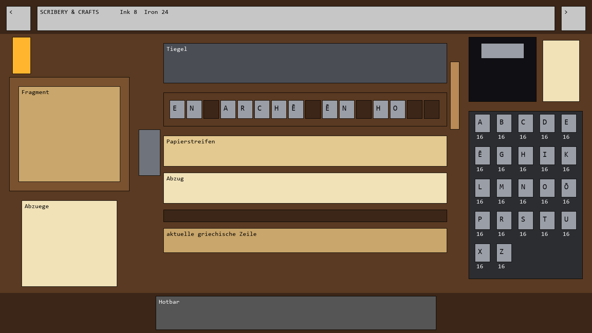
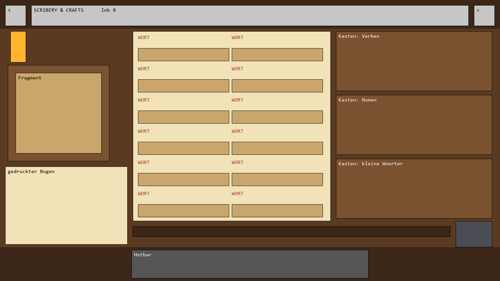

# UI-Spezifikation: Presse und Übersetzungs-Station

Stand: 15.11.2026. Gehört zu [plan.md](plan.md), Abschnitte 5 und 6. Ersetzt die frühere Datei `phase0-ui-spec.md`.

Die Zahlen stehen nur in [art/layout.json](../art/layout.json) (Presse), [art/tiles-layout.json](../art/tiles-layout.json) (Plättchen) und [art/palette.json](../art/palette.json). Dieses Dokument erklärt sie. `python art/mockup.py` zeichnet daraus die Kontrollbilder und meldet Überlappungen.

## 1. Leinwand

- **384 × 216 GUI-Pixel** (16:9), zentriert im Fenster.
- Passt ohne Skalierung bei 1920×1080 bis GUI-Scale 5 und im Standardfenster 854×480 bei Scale 2. Ist das Fenster kleiner, wird die Leinwand ganzzahlig herunterskaliert.
- **1 Texturpixel = 1 GUI-Pixel.** Keine Drehung, keine Glättung. Bewegung nur in ganzen Pixeln.
- Bisher gibt es keine Texturen: Alles ist aus Rechtecken in den Palettenfarben gezeichnet.

## 2. Der Bogen

Ein **Bogen** ist die Einheit, die durch die Stationen wandert: An der Presse wird er gedruckt, in der Übersetzungs-Station liegt er als gedruckter lateinischer Bogen unter dem Pult.

- Ein Bogen hat **vier Zeilen** mit je 17 Slots (17, damit das längste Wort des Evangeliums, μεθερμηνευόμενον, in eine Zeile passt). Gesetzt wird nur die lateinische Umschrift.
- Zeilen werden in `core` berechnet: Wörter in Textreihenfolge auffüllen, bis 17 Slots oder **drei Wörter** erreicht sind. Ein Bogen trägt damit höchstens zwölf Wörter, so viele, wie auf das Blatt der Übersetzungs-Station passen.
- Hat ein Fragment mehr als vier Zeilen, folgen weitere Bögen. Beide Stationen benutzen dieselbe Einteilung.

Beispiel `P1`: ein Bogen, Zeile 1 `EN ARCHĒ ĒN`, Zeile 2 `HO LOGOS`.

## 3. Presse

Links Kerze, Pult mit dem Fragment und der Stapel fertiger Zeilen. Mitte Kurbel, Tiegel, Setzform, Hebel, Papierablage und Hinweiszeile. Rechts Fass mit Walze, Papiervorrat, Buchstabenbox.

| Element | Maß (GUI-Pixel) | Anmerkung |
|---|---|---|
| Letter | 10 × 12 | in Box, am Cursor und in der Setzform gleich groß |
| Glyphe | 5 × 7, plus 2 Reihen für den Längenstrich | eigener Pixelsatz für beide Alphabete |
| Setzform | 184 × 61 | 4 Zeilen × 17 Slots, Slot-Abstand 10 (Letter stoßen aneinander), Zeilenabstand 13 |
| Papierablage | 184 × 59 | der Abzug kommt hierher zurück |
| Buchstabenbox | 74 × 109 | 5 × 5 Zellen, Vorratszahl unter jeder Letter |
| Walze am Cursor | 8 × 42 | erreicht mittig geführt alle vier Zeilen |

Regeln:

- **Alle Slots sind immer sichtbar und nutzbar.** Gesperrt sind nur die Leerstellen zwischen den Wörtern einer Zeile. Vorgedruckte Wörter (bis drei Buchstaben) stehen schon da.
- **Bedienung:** Lettern ziehen und loslassen. Walze, Papier, Kurbel und Hebel per Klick. Rechtsklick auf eine Letter in der Box gießt eine neue für ein Eisen.
- **Ergebnis:** Ein falsches Wort ist als Ganzes verwischt. Eine Letter an einer Stelle ohne Wort verwischt ebenfalls. Die Lettern bleiben liegen, die Farbe ist weg.
- Einfärben ist kein Zufallsfaktor. Die Kurbel verweigert, solange nicht alle gesetzten Lettern eingefärbt sind.

## 4. Übersetzungs-Station

Links das Pult mit dem Manuskript, darunter der gedruckte lateinische Bogen. In der Mitte das Blatt, das beschrieben wird. Rechts drei Kästen mit Plättchen, unten rechts das Federglas.

| Element | Maß (GUI-Pixel) | Anmerkung |
|---|---|---|
| Pult mit Fragment | 78 × 74 | wie in der Presse, zeigt die Wörter des aktuellen Bogens |
| Gedruckter Bogen | 94 × 60 | die lateinischen Wörter in Minecraft-Schrift, fortlaufend |
| Blatt | 152 × 146 | 2 × 6 Zellen, je Wort und Slot |
| Slot | 70 × 10 | |
| Plättchen | Textbreite + 4, höchstens 56 × 10 | Minecraft-Schrift, 8 Pixel hoch |
| Kasten | 120 × 46 | vier Reihen Plättchen |

Ablauf:

1. **Das Blatt ist zuerst leer.** Ein Klick auf ein Wort im Manuskript oder auf dem gedruckten Bogen lässt die Feder dieses Wort an seinen Platz schreiben; man hört sie. Darunter entsteht der Slot. Das Wort steht in der Schrift da, die man angeklickt hat; schon übertragene Wörter sind in der Vorlage blass.
2. **Plättchen in den Slot ziehen.** Ein Plättchen trägt ein Wort. Pro Wort liegen das richtige und bis zu drei falsche im Kasten.
3. **Klick auf das Federglas** schreibt alle gelegten Wörter und kostet eine Tinte. Ein richtiges Wort bleibt stehen, sein Plättchen ist verbraucht. Ein falsches verwischt, das Plättchen geht zurück.

Weitere Regeln:

- **Übersetzt wird nur, was gedruckt ist.** Ohne Abzug bleibt der Platz unter dem Pult leer, und Wörter lassen sich nicht anklicken.
- **Drei Kästen nach Wortart:** Verben, Nomen und Adjektive, alles andere. Jedes Plättchen hat einen festen Platz und hinterlässt eine Lücke.
- Passen die Plättchen eines Blatts nicht in die Kästen, bekommt jedes Wort entsprechend weniger falsche.

## 5. Stationswechsel

Die Pfeile in der Titelleiste wechseln zwischen Presse und Übersetzungs-Station. Das ist eine Abkürzung für `/scribery debug`; im Spiel sollen die Stationen eigene Blöcke werden, und der Abzug trägt als Item den Stand von Block zu Block.

## 6. Palette

28 Farben, festgelegt in [art/palette.json](../art/palette.json).

| Gruppe | Farben | Verwendung |
|---|---|---|
| Holz | `wood_0` bis `wood_4` | Tisch, Pult, Rahmen, Kästen, Plättchen |
| Blei und Eisen | `lead_0` bis `lead_4` | Lettern, Box, Tiegel, Kurbel, Walze |
| Pergament | `parchment_0` bis `parchment_3` | Fragment, Papier, Abzug |
| Tinte | `ink_0`, `ink_1` | Druckbild, Schrift |
| Fass | `barrel_full` bis `barrel_empty` | Füllstand: satt = voll, blass = leer |
| Flamme | `flame_0` bis `flame_2` | Kerze, Meldungen |
| Sonstiges | `smear`, `rubric` | Verwischtes; rote Auszeichnung |
| GUI | `gui_face`, `gui_shadow`, `gui_light` | Leiste und Pfeile im Vanilla-Ton |

## 7. Datenformat

Beispiel mit drei Platzhalter-Fragmenten: [tools/examples/fragments.example.json](../tools/examples/fragments.example.json).

| Feld | Bedeutung |
|---|---|
| `id` | `P1` bis `Pn`, in Textreihenfolge, eingefroren |
| `ref`, `chapter`, `tier`, `origin` | Stelle, Kapitel, Fundstufe, Fundort |
| `reference_en`, `notes` | Vergleichstext (nie Lösung), Randnotizen |
| `words[].greek`, `lemma`, `morph` | Wortform, Grundform, Grammatik. `morph` bestimmt den Kasten. |
| `words[].set` | optional. `false` = vorgedruckt, `true` = setzen. Fehlt es, entscheidet die Länge. |
| `words[].gloss.ok` | akzeptierte Glossen, die erste steht auf dem richtigen Plättchen |
| `words[].gloss.wrong` | falsche Plättchen |
| `words[].gloss.status` | `draft` oder `reviewed` |

Die lateinische Zielform steht nicht in den Daten. Sie wird aus `greek` per Umschrift berechnet.

## 8. Abweichungen vom Plan und offene Punkte

- **Wörter anklicken:** Im Plan liegt das Interlinear-Blatt mit allen Slots fertig da. Hier schreibt die Feder jedes Wort erst auf einen Klick hin.
- **Griechisch setzen** wurde ausprobiert und wieder verworfen; gesetzt wird nur die lateinische Umschrift.
- **Einseitige Plättchen** statt der zweiseitigen aus Abschnitt 5 des Plans; Rechtsklick zum Drehen entfällt.
- **Stationen als Blöcke** statt Wechsel per Pfeil.
- **IDs:** Das JSON-Beispiel im Plan nutzt `jhn-001-a` und `order`; festgelegt ist `P1` bis `Pn`.
- **Längstes Wort:** 17 Buchstaben (μεθερμηνευόμενον), deshalb 17 Slots. `ManuscriptDataTest` prüft, dass jedes Wort des Evangeliums passt.
- **[offen] Breite Glossen:** Ein Plättchen ist höchstens 56 Pixel breit, etwa neun bis zehn Buchstaben. Längere Glossen braucht eine Regel.
- **[offen] Umschrift:** Buchstabe für Buchstabe, γγ wird `GG`, υ immer `U`. Nicht bestätigt.
- **[offen] Glossen der Platzhalter** sind von Hand getippt und ungeprüft (`draft`).
